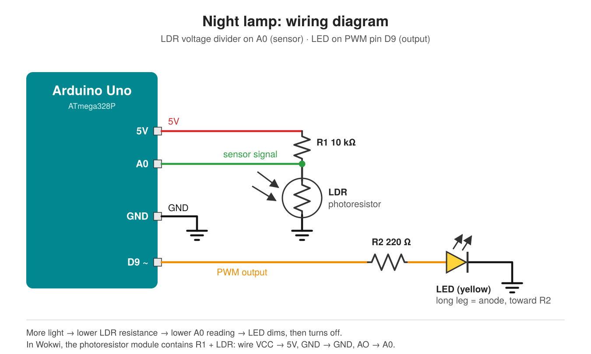

# Night Lamp: light sensor → LED (Task 01, Sensor and actuator)

An Arduino Uno reads a light sensor (LDR) every 100 ms and drives an LED in response:
**the darker the room, the brighter the LED.** In bright light the LED switches off.



| Requirement | Where it is |
|---|---|
| Sensor read at a sensible interval | `sketch.ino`, read every **100 ms** with non-blocking `millis()` timing, smoothed over 8 samples |
| An output that responds to the reading | LED on PWM pin D9: off in bright light, brightness scales with darkness |
| A wiring diagram | [`wiring-diagram.png`](wiring-diagram.png) / [`.svg`](wiring-diagram.svg), plus [`diagram.json`](diagram.json) for the Wokwi simulator |

## Parts

| Part | Qty |
|---|---|
| Arduino Uno (or Nano, same pins) | 1 |
| LDR / photoresistor (GL5528 or similar) | 1 |
| 10 kΩ resistor (R1, divider) | 1 |
| 220 Ω resistor (R2, LED current limit) | 1 |
| LED, any colour | 1 |
| Breadboard + jumper wires | |

## Wiring

| From | To | Purpose |
|---|---|---|
| Uno **5V** | R1 (10 kΩ), one end | top of divider |
| R1, other end | Uno **A0** *and* one leg of the LDR | divider midpoint = sensor signal |
| LDR, other leg | Uno **GND** | bottom of divider |
| Uno **D9** | R2 (220 Ω) | PWM output |
| R2, other end | LED **anode** (long leg) | |
| LED **cathode** (short leg) | Uno **GND** | |

In the Wokwi simulator, the *photoresistor module* contains R1 and the LDR on one board, so it needs only three wires: VCC → 5V, GND → GND, AO → A0. `diagram.json` is already wired this way.

## How to run

### Option A: Wokwi simulator (no hardware)

1. Open <https://wokwi.com/projects/new/arduino-uno>.
2. Replace the contents of the `sketch.ino` tab with [`sketch.ino`](sketch.ino).
3. Replace the contents of the `diagram.json` tab with [`diagram.json`](diagram.json).
4. Press **Start** (▶).
5. Click the photoresistor and drag the **lux** slider. Roughly:
   - ~1000 lux (bright room): LED off
   - ~300 lux (dim): LED turns on, faint
   - ~10 lux (dark): LED near full brightness
6. The Serial Monitor prints the reading once per second:
   ```
   level=512  lamp=ON   pwm=114
   ```

### Option B: real hardware

1. Wire the circuit as shown above.
2. Open `sketch.ino` in the Arduino IDE (it will offer to put it in a folder named `sketch`; accept).
3. Select **Tools → Board → Arduino Uno** and the right port, then **Upload**.
4. Open **Tools → Serial Monitor** at **9600 baud** and cover the LDR with your hand.

If your LDR or room lighting differs, watch the `level=` values in the Serial Monitor and adjust `DARK_ON`, `DARK_OFF` and `FULL_DARK` at the top of the sketch.

## How it works

```
every 100 ms:
  raw   = analogRead(A0)              0 (bright) .. 1023 (dark)
  level = average of the last 8 raw readings
  if lamp off and level >= DARK_ON (300)  -> lamp on
  if lamp on  and level <  DARK_OFF (250) -> lamp off
  if on: PWM = map(level, 250..900 -> 20..255)
  analogWrite(D9, PWM)
```

## Decisions

- **100 ms sample interval.** Room light changes slowly, so 10 readings per second is plenty to feel instant to a person, while leaving the CPU idle almost all the time. The Serial log runs at 1 s so the monitor stays readable.
- **`millis()` instead of `delay()`.** The loop never blocks, so more sensors or outputs can be added later without restructuring. The subtraction `now - lastSampleAt` also stays correct when `millis()` wraps after about 49 days.
- **8-sample moving average.** It removes ADC noise and brief shadows (a hand passing over the sensor) without making the lamp feel slow, since 8 × 100 ms = 0.8 s.
- **Hysteresis (on at 300, off at 250).** With a single threshold, the LED would flicker whenever the light sat near it. The 50-count gap stops that.
- **Proportional brightness, not just on/off.** PWM makes the output visibly *track* the reading, which is a clearer demonstration of "responds to the reading". It starts at PWM 20, not 0, so "on" is always visible.
- **Simulator first.** The project runs fully in Wokwi so a reviewer can check it without hardware. The same sketch runs unchanged on a real Uno.

## Tests

`test/` compiles the real `sketch.ino` on a normal computer against a small fake Arduino API and checks the behaviour: sampling interval, off in light, full brightness in the dark, hysteresis in both directions, spike filtering, and `millis()` overflow.

```sh
./test/run_tests.sh      # needs g++
```

```
sketch.ino tests
  ok   samples every 100 ms (10 reads in 1 s)
  ok   bright room: LED off
  ok   full dark: LED at full brightness
  ok   dim room: partial brightness
  ok   inside hysteresis band: stays ON
  ok   below DARK_OFF: turns OFF
  ok   inside hysteresis band: stays OFF
  ok   one-sample spike is filtered out by the moving average
  ok   timing survives millis() overflow

all tests passed
```

## Files

```
sketch.ino            Arduino sketch
diagram.json          Wokwi circuit (simulator)
wiring-diagram.svg    wiring diagram (source)
wiring-diagram.png    wiring diagram (image)
test/                 host-side tests for the sketch logic
```
